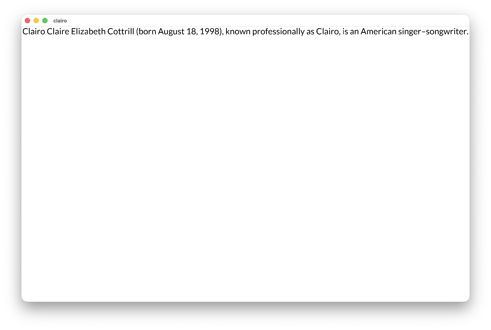

# clairo

A performative browser written in Rust and rendered with `wgpu`

`clairo` aims to build a browser with several components being written from scratch. So far, it includes a true type font renderer, a deflate decompressor, image decoders, and a basic layout engine

For things like tls and HTML parsing, I'm pretty content to use existing libraries

So far, `clairo` can fetch a wikipedia article and render some text:

